# Telegram Bot API Upgrade Roadmap (9.2 → 10.5)

Tracking plan for bringing **Teloxidium** (`crates/teloxide-core`, `crates/teloxide`, `crates/teloxide-macros`) from its initial **Bot API 9.2** starting baseline up to **Bot API 10.5**.

- **Current Baseline:** Bot API **10.0** (May 8, 2026) declared in [`crates/teloxide-core/schema.ron`](../crates/teloxide-core/schema.ron) and [`crates/teloxide-core/custom_v2.json`](../crates/teloxide-core/custom_v2.json) (upgraded from the M0 Bot API **9.2** baseline), plus selective Bot API 10.x support from commit `870ba033`:
  - Receive-only `RichMessage` (`Vec<serde_json::Value>`), `RichMessage::project()`, `MediaKind::RichMessage`, `TextQuote::rich_texts`, and optional `ExternalReplyInfo::kind`.
  - Ephemeral text menus (`SendMessage::ephemeral_message_parameters`, `EphemeralMessageId`, `EphemeralMessageParameters`, `Message::receiver_user`, `edit_ephemeral_message_reply_markup`, `delete_ephemeral_message`).
- **Target Baseline:** Bot API **10.5** (November 22, 2026) — 10 Bot API releases across 11 incremental milestones (**M0–M10**).

## Milestone Dependency Flow

```mermaid
flowchart LR
    M0["M0 (#2): Deser Safety\n(date_time entity + baseline)"] --> M1["M1 (#3): Bot API 9.3\n(Drafts, Gifts, Stories, Ratings)"]
    M1 --> M2["M2 (#4): Bot API 9.4\n(Button Styles, Profile Photo/Audio,\nVideoQuality, ChatOwner)"]
    M2 --> M3["M3 (#5): Bot API 9.5\n(Member Tags, DateTime, Open Drafts)"]
    M3 --> M4["M4 (#6): Bot API 9.6\n(Managed Bots, Polls v2,\nPrepared Buttons)"]
    M4 --> M5["M5 (#7): Bot API 10.0\n(Guest Mode, Live Photos,\nPolls Media, Reactions, Access)"]
    M5 --> M6["M6 (#8): Bot API 10.1\n(Rich Messages Send/Draft/Edit)"]
    M6 --> M7["M7 (#9): Bot API 10.2\n(Rich Builders, Communities,\nSubscriptions, Ephemeral Edits)"]
    M7 --> M8["M8 (#10): Bot API 10.3\n(Rich Buttons/Blocks,\nAll-Send Ephemeral Params)"]
    M8 --> M9["M9 (#11): Bot API 10.4\n(HTML Widgets, Live Photos,\nEphemeral Replies/Callbacks)"]
    M9 --> M10["M10 (#12): Bot API 10.5\n(BotFullInfo, setMySettings,\nAccess Settings, Inviter)"]
```



## Master Tracking Table

| Status | Milestone | Bot API Version & Date | GitHub Ticket | Breaking Changes | Summary |
| :---: | :--- | :--- | :--- | :---: | :--- |
| `[x]` | **M0** | Hotfix + Baseline (`9.2`) | [#2](https://github.com/sailself/teloxidium/issues/2) | `[**BC**]` | Add `MessageEntityKind::DateTime` deserialization safety and verify baseline CI |
| `[x]` | **M1** | **9.3** (2025-12-31) | [#3](https://github.com/sailself/teloxidium/issues/3) | `[**BC**]` | `sendMessageDraft`, `getUserGifts`, `getChatGifts`, `repostStory`, `GiftBackground`, `UniqueGiftColors`, `UserRating`, `has_topics_enabled`, `UniqueGiftInfo`, `getBusinessAccountGifts` |
| `[x]` | **M2** | **9.4** (2026-02-09) | [#4](https://github.com/sailself/teloxidium/issues/4) | `[**BC**]` | Button `style` + `icon_custom_emoji_id`, `setMyProfilePhoto`/`removeMyProfilePhoto`, `UserProfileAudios`, `VideoQuality`, `UniqueGift::is_burned`/`UniqueGiftModel::rarity`, `ChatOwnerLeft`/`Changed` |
| `[x]` | **M3** | **9.5** (2026-03-01) | [#5](https://github.com/sailself/teloxidium/issues/5) | `[**BC**]` | Chat member `tag` / `sender_tag` / `setChatMemberTag` / `EDIT_TAG`, full `9.5` schema refresh, unrestricted `sendMessageDraft` |
| `[x]` | **M4** | **9.6** (2026-04-03) | [#6](https://github.com/sailself/teloxidium/issues/6) | `[**BC**]` | Managed Bots (`UpdateKind::ManagedBot`, tokens), `savePreparedKeyboardButton`, Polls v2 (`correct_option_ids`, revoting, persistent IDs, `sendPoll` options) |
| `[x]` | **M5** | **10.0** (2026-05-08) | [#7](https://github.com/sailself/teloxidium/issues/7) | `[**BC**]` | Guest Mode (`UpdateKind::GuestMessage`, `answerGuestQuery`), Live Photos (`LivePhoto`, `sendLivePhoto`), Polls media/restrictions (`PollMedia`, `sendPoll`), `deleteAllMessageReactions`/`deleteMessageReaction`, `REACT_TO_MESSAGES`, `getChatAdministrators::return_bots`, `BotAccessSettings`, `getUserPersonalChatMessages` |
| `[ ]` | **M6** | **10.1** (2026-06-11) | [#8](https://github.com/sailself/teloxidium/issues/8) | `[**BC**]` | Typed `RichText` & `RichBlock`, `InputRichMessage`, `sendRichMessage`, `sendRichMessageDraft`, `editMessageText::rich_message`, join request queries (`answerChatJoinRequestQuery`, `sendChatJoinRequestWebApp`, `guard_bot`), `PollMedia::link` / `InputMediaLink` |
| `[ ]` | **M7** | **10.2** (2026-07-14) | [#9](https://github.com/sailself/teloxidium/issues/9) | `[**BC**]` | `InputRichMessageMedia` & `InputRichBlock*`, `InputMediaVoiceNote`, Communities, `UpdateKind::Subscription`, ephemeral edit methods (`editEphemeralMessageText`/etc.), `ReplyParameters::ephemeral_message_id`, `BotCommand.is_ephemeral` |
| `[ ]` | **M8** | **10.3** (2026-08-24) | [#10](https://github.com/sailself/teloxidium/issues/10) | `[**BC**]` | `RichMessageButton`, rich button/document/quote blocks, `ephemeral_message_parameters` on 13 existing + `sendRichMessage` methods, streaming `can_stop`/`keep_on_stop`, `stopped_message_generation`, `CommunityChatJoined`, `DisabledButton`, `force_reply`, `can_send_welcome_messages`, `editEphemeralMessageText.rich_message` |
| `[ ]` | **M9** | **10.4** (2026-11-09) | [#11](https://github.com/sailself/teloxidium/issues/11) | `[**BC**]` | HTML Widgets (`sendWidget`, `sendSharedWidget`, `widget_query`/`shared_widget_query`, `answerWidgetQuery`, `edit*WidgetData`), TON wallet & NFTs, chat share themes, `StoryAreaPosition`→`AreaPosition`, `getUniqueGift`/`deleteBusinessAccountGift`, `PaidMessagesWaived` (Live Photos & `bank_card_number`/`ton_address` entities landed earlier) |
| `[ ]` | **M10** | **10.5** (2026-11-22) | [#12](https://github.com/sailself/teloxidium/issues/12) | `[**BC**]` | `BotFullInfo` split from `User` (plus `User` 9 bot-field exemptions), `setMySettings`, `WriteAccessAllowed::inviter` (`BotAccessSettings` & `getUserPersonalChatMessages` landed in M5) |

---

## Repeatable Per-Milestone Technical Checklist

Execute this checklist for every milestone **M1–M10**:

1. **Official Spec Verification**
   - Verify exact wire field names, requiredness, integer widths, defaults, and return types against the [official Bot API reference](https://core.telegram.org/bots/api) and [Bot API changelog](https://core.telegram.org/bots/api-changelog).
2. **Wire Types (`crates/teloxide-core/src/types/`)**
   - Derive `Clone, Debug, PartialEq, Serialize, Deserialize` (+ `Eq, Hash` where fields permit) and `#[cfg_attr(test, derive(schemars::JsonSchema))]`.
   - Use `#[serde_with::skip_serializing_none]`, `#[serde(default)]` on optional booleans, and `#[cfg_attr(test, schemars(with = "..."))]` for custom-serde fields (`DateTime<Utc>`, `MessageId`, `Mime`).
   - Wrap new IDs in strongly-typed newtypes (`DraftId`, `GuestQueryId`, `WidgetId`, etc.) and re-export all new types in [`crates/teloxide-core/src/types.rs`](../crates/teloxide-core/src/types.rs).
   - Preserve variant ordering in `#[serde(untagged)]` enums (`MessageKind`, `MediaKind`, `InputMessageContent`) and preserve highest-precedence key order in [`ExternalReplyInfo`](../crates/teloxide-core/src/types/external_reply_info.rs) custom deserialization.
3. **Method Schema & Codegen**
   - Generate [`crates/teloxide-core/custom_v2.json`](../crates/teloxide-core/custom_v2.json) from the official per-version Bot API documentation (for example via `teloxide/tba-parser` against an archived snapshot) rather than hand-editing entries, update [`crates/teloxide-core/schema.ron`](../crates/teloxide-core/schema.ron) (and [`crates/teloxide-core/src/codegen/patch.rs`](../crates/teloxide-core/src/codegen/patch.rs) if overrides are needed), and verify against the official spec directly.
   - Regenerate payloads, setters, `Requester`, and schema checks:
     ```powershell
     cargo test --locked -p teloxide-core --features "full nightly" --lib codegen_
     ```
4. **Client & Adaptor Wiring (`crates/teloxide-core/src/`)**
   - [`bot/api.rs`](../crates/teloxide-core/src/bot/api.rs): choose `JsonRequest` vs `MultipartRequest` (any payload carrying `InputFile` directly or inside nested types must use `MultipartRequest`, expose `files()` / `files_mut()` or `InputFileLike`, and pass `check_multipart_requests` in [`ron_check.rs`](../crates/teloxide-core/src/codegen/schema_check/ron_check.rs)).
   - [`requests/requester.rs`](../crates/teloxide-core/src/requests/requester.rs): `forward_all!`.
   - [`adaptors/cache_me.rs`](../crates/teloxide-core/src/adaptors/cache_me.rs) & [`adaptors/trace.rs`](../crates/teloxide-core/src/adaptors/trace.rs): `requester_forward!`.
   - [`adaptors/erased.rs`](../crates/teloxide-core/src/adaptors/erased.rs): `ErasedRequester` trait + impl + `requester_forward!`.
   - [`adaptors/parse_mode.rs`](../crates/teloxide-core/src/adaptors/parse_mode.rs): first `requester_forward!` + `VisitParseModes` for methods carrying `ParseMode`, `InputMedia`, `InlineQueryResult`, or `InputRichMessage`; second `requester_forward!` otherwise.
   - [`adaptors/throttle/requester_impl.rs`](../crates/teloxide-core/src/adaptors/throttle/requester_impl.rs): first `requester_forward!` (or `Option<ChatIdHash>` extractor) for rate-limited send methods; second `requester_forward!` otherwise.
5. **Dispatcher, Sugar & Filters (`crates/teloxide/src/`)**
   - For new `UpdateKind` variants: update [`update.rs`](../crates/teloxide-core/src/types/update.rs) (`UpdateKind`, `Update::{from, chat, mentioned_users}`, serde), [`allowed_update.rs`](../crates/teloxide-core/src/types/allowed_update.rs) (`AllowedUpdate`), [`handler_description.rs`](../crates/teloxide/src/dispatching/handler_description.rs) (`Kind::full_set()` + `allowed_updates_full_set`), [`get_chat_id.rs`](../crates/teloxide/src/dispatching/dialogue/get_chat_id.rs) (`GetChatId`), and [`filter_ext.rs`](../crates/teloxide/src/dispatching/filter_ext.rs) (`UpdateFilterExt`).
   - For new `MessageKind` / `MediaKind` / `Message` fields: add getters and `mentioned_users()` entries in [`message.rs`](../crates/teloxide-core/src/types/message.rs), and filters in [`filter_ext.rs`](../crates/teloxide/src/dispatching/filter_ext.rs) (`MessageFilterExt`).
   - For new reply-capable send methods: implement `RequestReplyExt` in [`sugar/request.rs`](../crates/teloxide/src/sugar/request.rs).
6. **JSON Fixtures & Verification**
   - Add one `Update`-level fixture per new enum value / entity type alongside round-trip JSON tests and legacy omitted-field backwards-compatibility tests.
   - Run the full verification suite:
     ```powershell
     cargo test --locked -p teloxide-core --features "full nightly" --lib codegen_
     cargo test --locked -p teloxide-core --features "full nightly" --lib schema_check
     cargo fmt --all -- --check
     cargo build --locked --workspace --features "full nightly"
     cargo test --locked --workspace --features "full nightly" --lib --tests
     cargo clippy --locked --workspace --all-targets --features "full nightly" -- -D warnings
     cargo check --locked -p teloxide-core --no-default-features --features "rustls"
     cargo check --locked -p teloxide --no-default-features --features "rustls macros"
     git diff --check
     ```
7. **Version Markers & Release Notes**
   - Update `api_version` in [`crates/teloxide-core/schema.ron`](../crates/teloxide-core/schema.ron), doc comments in [`crates/teloxide-core/src/lib.rs`](../crates/teloxide-core/src/lib.rs) and [`crates/teloxide/src/lib.rs`](../crates/teloxide/src/lib.rs), badges in [`README.md`](../README.md) and [`crates/teloxide-core/README.md`](../crates/teloxide-core/README.md), changelogs, and [`MIGRATION_GUIDE.md`](../MIGRATION_GUIDE.md) (`[**BC**]`).
   - Bump crate SemVer versions per [`RELEASE_PROCEDURE.md`](../RELEASE_PROCEDURE.md) (minor bump for `[**BC**]`, patch bump for additive releases) and tag `v<teloxide-version>` on `master` after each Bot API milestone merges (no `-m*` tag suffixes).

---

## Key Architectural Decisions to Confirm

1. **Schema Sync Cadence (`custom_v2.json`):**
   - **Recommended:** Update `custom_v2.json` incrementally per milestone (via `teloxide/tba-parser` against archived/pinned docs or scoped edits) so `schema_check` passes at every step.
   - **Alternative:** Regenerate `custom_v2.json` directly for `10.5` upfront and work through the diff sequentially.
2. **Incoming `RichMessage::blocks` Representation (M6–M8, M10):**
   - **Recommended:** Keep `RichMessage { blocks: Vec<serde_json::Value>, is_rtl: Option<bool> }` and `RichMessage::project()` intact for incoming deserialization (preserving unknown future block types), while adding strongly-typed `InputRichMessage` / `InputRichBlock` / `RichText` / `RichMessageButton` types for outgoing requests.
   - **Alternative:** Replace `RichMessage::blocks` with `Vec<RichBlock>` featuring an `Unknown(Value)` fallback (`[**BC**]` for existing fork callers).
3. **`Me` vs `BotFullInfo` Naming (M10):**
   - **Recommended:** Keep `Me` as the return type of `get_me`, extend it with all Bot API 10.5 `BotFullInfo` fields, export `pub type BotFullInfo = Me;`, and map `BotFullInfo` → `Me` in `rust_types_check_codegen.rs`.
   - **Alternative:** Rename `Me` → `BotFullInfo` (`[**BC**]`).
4. **Optional `chat_id` on Ephemeral Callback Replies & `CallbackQueryMode` (M9–M10):**
   - **Tension:** Keeping `chat_id` mandatory on `send_message(chat_id, text)` conflicts with Bot API 10.5 `CallbackQueryMode` when callback queries from the bot's own messages arrive with `inline_message_id` and no `message` (leaving `Update::chat()` / `GetChatId` `None`). Re-evaluate making `chat_id` optional on the 14 ephemeral-capable send methods (or adding callback-only builders without `chat_id`) before implementing M9/M10 rather than forcing callers to pass a dummy `ChatId`.
5. **Fork Metadata & Pinned Toolchain (M0 — Confirmed):**
   - Pointed `homepage`/`repository` in [`Cargo.toml`](../Cargo.toml) to `https://github.com/sailself/teloxidium`, and kept [`rust-toolchain.toml`](../rust-toolchain.toml) pinned to `nightly-2025-06-12` (coordinated with CI and `rustfmt.toml`).

---

## Milestone Breakdown

### M0 — Deserialization Safety (`date_time` Entity) & Baseline ([#2](https://github.com/sailself/teloxidium/issues/2))
- **Goal:** Prevent live Bot API 9.5+ `date_time` message entities from breaking `Update` deserialization while validating the baseline workspace.
- **Key changes (`[**BC**]`):** `MessageEntityKind::DateTime { unix_time: DateTime<Utc>, date_time_format: Option<String> }` + `MessageEntity::date_time(...)` + `Renderer` HTML/MarkdownV2 support + UTF-16 `MessageEntityRef::parse` / `Message::parse_caption_entities` / `serde_multipart` tests; `MessageEntity` synced in `custom_v2.json`; `Cargo.toml` fork metadata updated.

### M1 — Bot API 9.3 ([#3](https://github.com/sailself/teloxidium/issues/3))
- **Goal:** Support streaming drafts, user/chat gifts, cross-account business story reposts, gift backgrounds, unique gift color schemes, user ratings, and Bot API 9.3 schema updates.
- **Key changes (`[**BC**]`):** `DraftId`, `GiftBackground`, `UniqueGiftColors`, `UserRating`; updates to `Me` (`has_topics_enabled`), `Gift`, `UniqueGift` (`gift_id`, `is_premium`, `is_from_blockchain`, `colors`), `GiftInfo` & `OwnedGiftRegular`, `UniqueGiftInfo` (`last_resale_currency`/`last_resale_amount`, `UniqueGiftOrigin::{GiftedUpgrade, Offer}`), `AcceptedGiftTypes::gifts_from_channels`, `ForumTopic*`, `ChecklistTask::completed_by_chat`, `ChatFullInfo`, `MessageKind::GiftUpgradeSent` + `filter_gift_upgrade_sent`; methods `sendMessageDraft` (`VisitParseModes`, throttled), `getUserGifts`, `getChatGifts`, `repostStory`, updated `getBusinessAccountGifts`, `forwardMessage`/`copyMessage::message_effect_id`, and 25,000 Stars paid media docs.

### M2 — Bot API 9.4 ([#4](https://github.com/sailself/teloxidium/issues/4))
- **Goal:** Support styled/custom-emoji buttons, bot profile photos, user profile audios, video quality variants, crafted unique gift metadata (`is_burned`, `rarity`), and chat ownership service messages.
- **Key changes (`[**BC**]`):** `ButtonStyle` + `icon_custom_emoji_id` on `KeyboardButton`/`InlineKeyboardButton`; `UserProfileAudios`, `VideoQuality` (`Video::qualities`), `ChatFullInfoPrivate::first_profile_audio`, `Me::allows_users_to_create_topics`, `UniqueGift::is_burned`, `UniqueGiftModel::rarity` (`UniqueGiftModelRarity`); `MessageKind::{ChatOwnerLeft, ChatOwnerChanged}` + `filter_chat_owner_left`/`filter_chat_owner_changed`; methods `setMyProfilePhoto` (`MultipartRequest`), `removeMyProfilePhoto`, `getUserProfileAudios`, and updated `SetBusinessAccountProfilePhoto` (`MultipartRequest`).

### M3 — Bot API 9.5 ([#5](https://github.com/sailself/teloxidium/issues/5))
- **Goal:** Perform the full Bot API 9.5 schema/version refresh (building on the `MessageEntity` `date_time` entry synced in M0) and add chat member tags & tag permissions.
- **Key changes (`[**BC**]`):** `ChatMember` (`Member::tag`, `Restricted::tag`, `Restricted::can_edit_tag`, `Administrator::can_manage_tags: Option<bool>`, `ChatMemberKind::{tag, can_manage_tags}`), `ChatAdministratorRights` (`can_manage_tags: Option<bool>`, `can_manage_direct_messages: Option<bool>`), `ChatPermissions::EDIT_TAG` (`1 << 14`), `Message::sender_tag`; methods `setChatMemberTag`, `promoteChatMember::can_manage_tags`; unrestricted `sendMessageDraft` and `date_time` `ParseMode` docs.

### M4 — Bot API 9.6 ([#6](https://github.com/sailself/teloxidium/issues/6))
- **Goal:** Add Managed Bots, Prepared Keyboard Buttons, and the Polls v2 overhaul.
- **Key changes (`[**BC**]`):** `Poll::{allows_revoting, correct_option_ids, description, description_entities}` (replacing `correct_option_id`), `PollOption::{persistent_id, added_by_user, added_by_chat, addition_date}`, `PollAnswer::option_persistent_ids`, `ReplyParameters::poll_option_id`, `MessageCommon::reply_to_poll_option_id`, `PollOptionAdded`/`PollOptionDeleted`; `KeyboardButtonRequestManagedBot`, `ManagedBotCreated`, `ManagedBotUpdated` (`UpdateKind::ManagedBot`, `AllowedUpdate::ManagedBot`, `filter_managed_bot`), `PreparedKeyboardButton`, `Me::can_manage_bots`; methods `getManagedBotToken`, `replaceManagedBotToken`, `savePreparedKeyboardButton`, updated `sendPoll` (`allows_revoting`, `shuffle_options`, `allow_adding_options`, `hide_results_until_closes`, `correct_option_ids`, `open_period: u32`, `description*` with `VisitParseModes`), and `date_time` docs across quotes/checklists/gifts.

### M5 — Bot API 10.0 ([#7](https://github.com/sailself/teloxidium/issues/7))
- **Goal:** Complete Bot API 10.0 parity covering Guest Mode, Live Photos, Poll Media & Restrictions, Chat Management (`REACT_TO_MESSAGES`, reaction deletion, admin bots), Managed Bot Access Settings, Personal Chat Messages, and empty placeholder drafts.
- **Key changes (`[**BC**]`):**
  - Guest Mode: `GuestQueryId`, `SentGuestMessage`, `Me::supports_guest_queries`, `Message::{guest_bot_caller_user, guest_bot_caller_chat, guest_query_id}`, `UpdateKind::GuestMessage` / `AllowedUpdate::GuestMessage` + `filter_guest_message`, `answerGuestQuery` (`VisitParseModes`).
  - Live Photos: `LivePhoto`, `InputMediaLivePhoto`, `PaidMediaLivePhoto`, `InputPaidMediaLivePhoto`, `MediaLivePhoto` / `MediaKind::LivePhoto` + `ExternalReplyInfoKind::LivePhoto`, `Message::live_photo()` + `filter_live_photo`, `sendLivePhoto` (`MultipartRequest`, `VisitParseModes`, `Throttle`, `RequestReplyExt`).
  - Polls: `PollMedia`, `InputPollMedia`, `InputPollOptionMedia`, `InputMediaSticker`/`Location`/`Venue`, `Poll::{media, explanation_media, members_only, country_codes}`, `PollOption::media`, `InputPollOption::media`, `sendPoll` (`MultipartRequest` / `MultipartPayload`, `1-12` options).
  - Chat Management & General: `ChatPermissions::REACT_TO_MESSAGES` (`1 << 15`), `Restricted::can_react_to_messages`, `getChatAdministrators::return_bots`, `deleteAllMessageReactions`, `deleteMessageReaction`, `BotAccessSettings`, `getManagedBotAccessSettings`, `setManagedBotAccessSettings`, `getUserPersonalChatMessages`, `sendMessageDraft` empty-text placeholder docs.

### M6 — Bot API 10.1 ([#8](https://github.com/sailself/teloxidium/issues/8))
- **Goal:** Add outgoing, streaming, and editable Rich Messages, join request query answering, and Bot API 10.1 alignments alongside deferred breaking parameter fixes.
- **Key changes (`[**BC**]`):** Split `rich_message.rs` into `rich_message/{mod.rs, text.rs, blocks.rs, input.rs}`; typed `RichText` (untagged `String | Vec<RichText> | object`) & `RichBlock` (with explicit wire `#[serde(rename = "...")]` tags for `heading`, `pre`, `blockquote`, `expandable_blockquote`, `pullquote`), `InputRichMessage`, `InputRichMessageContent` (`InputMessageContent::RichMessage`); methods `sendRichMessage`, `sendRichMessageDraft`, `editMessageText::rich_message` (making `edit_message_text`'s `text` optional); join request queries (`answerChatJoinRequestQuery`, `sendChatJoinRequestWebApp`, `ChatFullInfo.guard_bot`, `ChatJoinRequest.query_id`, `supports_join_request_queries`); `PollMedia::link` / `InputMediaLink`; fold deferred 10.0 signature fixes (`sendGame`/`sendChecklist`/`editMessageChecklist` `chat_id` → `Recipient`, `sendMessageDraft.text` optional); and evaluate dialogue keying for `UpdateKind::BusinessMessage` (business connection chat scope) alongside `Throttle::send_message_draft` rate-limiting.

### M7 — Bot API 10.2 ([#9](https://github.com/sailself/teloxidium/issues/9))
- **Goal:** Add rich block input builders/media, voice-note album media, Communities, payment subscription updates, full ephemeral edit methods, ephemeral reply targets, and ephemeral bot commands.
- **Key changes (`[**BC**]`):** `InputRichMessageMedia` (`MultipartRequest`), `InputRichBlock*` (matching non-snake_case wire tags), `InputMediaVoiceNote`, `Community` / `CommunityChatAdded` / `CommunityChatRemoved`, `BotSubscriptionUpdated` (`UpdateKind::Subscription` + filter + `AllowedUpdate`), `editEphemeralMessageText` / `editEphemeralMessageCaption` / `editEphemeralMessageMedia`, `ReplyParameters::{ephemeral_message_id, message_id: Option<MessageId>}`, and `BotCommand.is_ephemeral`.

### M8 — Bot API 10.3 ([#10](https://github.com/sailself/teloxidium/issues/10))
- **Goal:** Add interactive Rich Message buttons/blocks, streaming stop controls, community join events, markup `force_reply`, welcome-message admin rights, rich unique-gift info, and `ephemeral_message_parameters` across the 14 supported send methods.
- **Key changes (`[**BC**]`):** `RichMessageButton` (`style` including `"link"`), rich button/document/quote blocks, `RichBlockTable::is_compact`; `editEphemeralMessageText.rich_message` & `editEphemeralMessageCaption.show_caption_above_media`; `ephemeral_message_parameters` on the 13 existing methods (`sendMessage`, `sendAnimation`, `sendAudio`, `sendContact`, `sendDocument`, `sendLivePhoto`, `sendLocation`, `sendPhoto`, `sendSticker`, `sendVenue`, `sendVideo`, `sendVideoNote`, `sendVoice`) plus `sendRichMessage`; streaming `can_stop`/`keep_on_stop`, `MessageGenerationStopped` (`UpdateKind::StoppedMessageGeneration`), `CommunityChatJoined`, `DisabledButton`, `force_reply` on `InlineKeyboardMarkup`/`ReplyKeyboardMarkup`, `can_send_welcome_messages`, `UniqueGiftInfo.{text, entities, is_private}`.

### M9 — Bot API 10.4 ([#11](https://github.com/sailself/teloxidium/issues/11))
- **Goal:** Add HTML Widgets & widget queries, TON wallet cards & transfers, chat share themes, gift query/delete endpoints, paid message waiver notices, and `AreaPosition` (building on Live Photos & `bank_card_number`/`ton_address` entities already shipped in `v0.23.x`).
- **Key changes (`[**BC**]`):** `WidgetId`, `Widget`, `MediaKind::Widget`, `ExternalReplyInfoKind::Widget`, `UpdateKind::{WidgetQuery, SharedWidgetQuery}`, `answerWidgetQuery`, `editMessageWidgetData`, `editSharedWidgetData`, `Input*WidgetMessageContent`, `filter_widget`, `sendWidget`, `sendSharedWidget`; `TonWalletCard*`/`TonNft*`/`TonWalletTransfer`; breaking rename `StoryAreaPosition` → `AreaPosition`; `ChatShareTheme*`/`EmojiType*`/`getChatShareThemeBackdrops`; `getUniqueGift`, `deleteBusinessAccountGift`; `PaidMessagesWaived`; `ReplyParameters.quote_rich_texts`, `RichTextTonAddress`, `verifyUser`/`verifyChat` custom description formatting; and re-evaluation of optional `chat_id` on the 14 ephemeral send methods.

### M10 — Bot API 10.5 ([#12](https://github.com/sailself/teloxidium/issues/12))
- **Goal:** Complete Bot API 10.5 parity with `BotFullInfo`, `setMySettings`, bulk invite tracking, and updated expandable block quotations (building on `BotAccessSettings` and `getUserPersonalChatMessages` landed in M5).
- **Key changes (`[**BC**]`):** `CallbackQueryMode`, `Me`/`BotFullInfo` new fields (`User` 9 bot-only fields removed + `rust_types_check_codegen.rs` cleanup), `WriteAccessAllowed::inviter`, `CallbackQuery` doc updates (including optional `chat_id` impact when `inline_message_id` arrives without `message`), `RichBlockExpandableBlockQuotation` (`text` → `blocks`), method `setMySettings`, and final `10.5` badges/docs.
